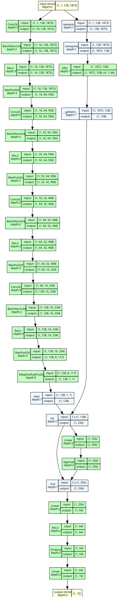
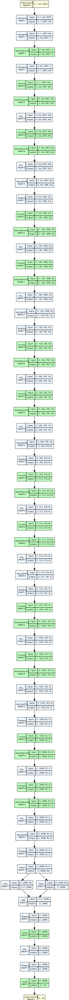
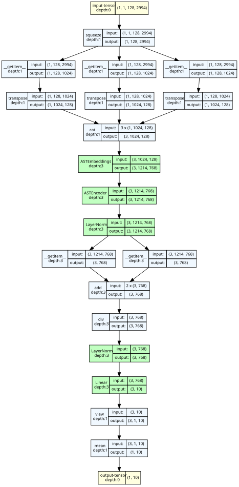

# DL and GenAI project, IITM BS Data Sc, Jan 2026 Term
# 🎵 Music Mashup Genre Classifier

This project was built to classify 30-second audio mashups into 10 distinct music genres using Log-Mel Spectrograms and state-of-the-art Deep Learning models.

This repository contains all the code used for data preparation, model training, evaluation, ensembling, and deployment for our Kaggle competition submission.

### 🔗 Quick Links

  * **📝 Project Report:** [Read the full report here](23f1002830_DG_T12026.pdf)
  * **🚀 Live Demo:** [Hugging Face](https://huggingface.co/spaces/Bhavya-Goyal-Hf/ProjectDLGenAiJan26)
  * **📊 Training Logs:** [WandB](https://wandb.ai/23f1002830-dl-genai-project/dl-genai-project-t12026)
  * **🏆 Kaggle Competition:** [Messy Mashup](https://www.kaggle.com/competitions/jan-2026-dl-gen-ai-project)

-----

## 📂 Repository Structure

The codebase is highly modular, separating the training loops, inference scripts, dataset logic, and models into clean directories.

```text
.
├── 23f1002830_DG_T12026.pdf  # Final project report detailing methodology and results
├── deployment/               # Hugging Face Gradio app for live inference
├── ensemble/                 # Logic for blending model logits and generating submissions
├── inference/                # Scripts to run single-model inference on test data
├── milestones/               # Jupyter notebooks tracking the 5 milestones
├── models/                   # PyTorch model classes and architecture diagrams (.svg)
├── training/                 # Modular training/validation loops and trigger scripts
├── utility/                  # Datasets, data prep, train/val split logic, and W&B setup
├── README.md                 # You are here!
└── requirements.txt          # Python dependencies
```

-----

## 🧠 Models Overview

We experimented with three distinct architectures. Our final Kaggle submission utilized an optimized ensemble of the AST and CNN14 models.

### 1. Custom CRNN

A custom architecture built from scratch featuring a 2D CNN branch for spatial features and a 1D GRU branch for sequential/temporal tracking. *(Note: While it performed well on validation, it heavily overfit to the training distribution and was excluded from the final ensemble).*

<p align="center">
  
</p>

### 2. CNN14 (PANNs)

A 14-layer VGG-style Convolutional Neural Network. Excellent at catching specific, microscopic local audio textures (like the distortion of a guitar or the snap of a snare drum).

<p align="center">
  
</p>

### 3. Audio Spectrogram Transformer (AST)

The heavy lifter of our ensemble. Instead of using convolutions, the AST uses self-attention mechanisms across the entire 30-second spectrogram (3- 10 seconds chunks in real) to understand the global context of the song. Highly robust and generalized incredibly well.

<p align="center">
  
</p>

-----

## ⚙️ Getting Started

### 1. Clone the Repository

```bash
git clone https://github.com/Bhavya-Goyal-Git/dl-genai-project-26-t1.git
cd dl-genai-project-26-t1
```

### 2. Set Up a Virtual Environment

It is highly recommended to use a virtual environment to manage dependencies.

```bash
# Create the virtual environment
python3 -m venv venv

# Activate it
source venv/bin/activate
```

### 3. Install Dependencies

```bash
pip install -r requirements.txt
```

-----

## 🚀 Usage Guide

### Data Preparation

Before training, ensure your raw `.wav` files are converted to PyTorch tensors and your dataset is split.

1.  Run `python utility/tensorDataPrep.py` to convert audio to `.pt` files.
2.  Run `python utility/trainValSplit.py` to generate the 85:15 `dataset_split.json`.

### Training

Models are trained using Weights & Biases for live tracking. You can trigger training for a specific model using the scripts in the `training/` directory.

```bash
# Example: Train the Audio Spectrogram Transformer
python training/train_ast.py

# Example: Train the CNN14
python training/train_cnn14.py
```

### Inference (Single Model)

To generate predictions for the Kaggle test set using a single model, run its respective inference script. This will output a CSV with proper genre names.

```bash
python inference/infer_ast.py
```

### Ensembling

To improve score, we blend the raw logits of the AST and CNN14 models before taking the final `argmax`.

1.  Ensure you load models with best weights (trained)
2.  Run the ensembler to combine raw logits and generate `submission.csv`.

```bash
python ensemble/ensembler.py
```

### Deployment

To run the Hugging Face Gradio interface locally:

```bash
python deployment/app.py
```

*(Note: Ensure you have your `best.pth` model weights downloaded or linked via Hugging Face Hub as per the `app.py` script logic).*

-----

*Built with PyTorch, Torchaudio, and Gradio.*